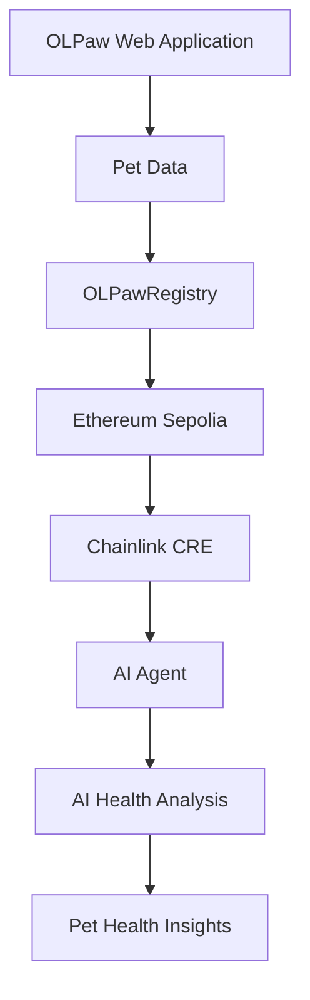

# 🐾 OLPaw AI Agent — Chainlink CRE

> **An AI-powered pet health intelligence layer built with Chainlink Runtime Environment (CRE), designed to work with the OLPaw Web3 pet identity and data platform.**

[](https://chain.link/)
[](https://sepolia.etherscan.io/)
[](https://github.com/icepack8/olpawAI)
[](LICENSE)

---

# 🌎 What is OLPaw AI Agent?

**OLPaw AI Agent** is the AI intelligence layer of **OLPaw**, a Web3-based digital identity and health data platform for cats and dogs.

The main OLPaw application provides the pet's structured digital identity, including:

* 🐱 Pet identity
* 🧬 DNA information
* 💉 Vaccination records
* 🏥 Medical history
* 🌳 Pedigree
* 👤 Ownership information

The AI Agent adds an intelligence layer on top of this data.

Instead of simply storing pet information, OLPaw can use AI to **analyze structured pet data and turn it into understandable health insights.**

---

# 🧩 OLPaw Ecosystem

OLPaw is designed as two connected layers:

```text
                    OLPaw Ecosystem
                          │
             ┌────────────┴────────────┐
             │                         │
             ▼                         ▼
       OLPaw Application        OLPaw AI Agent
       ────────────────          ─────────────
       Pet Identity              AI Intelligence
       DNA                       Health Analysis
       Vaccination               Risk Signals
       Medical Data              Recommendations
       Pedigree
       Ownership
             │                         │
             └────────────┬────────────┘
                          │
                          ▼
                   Chainlink CRE
                          │
                          ▼
                 Ethereum Sepolia
```

### Main Repository

The complete OLPaw application is maintained here:

👉 **https://github.com/icepack8/olpawAI**

### AI Agent Repository

This repository contains the AI Agent and Chainlink CRE implementation:

👉 **https://github.com/icepack8/olpaw-ai-agent**

The two repositories are therefore **parts of the same OLPaw project**, rather than independent products.

---

# 🔗 Why Chainlink CRE?

The OLPaw AI Agent uses **Chainlink Runtime Environment (CRE)** to provide a workflow layer connecting blockchain-based pet data with off-chain computation and AI.

The goal is to make the AI component part of a reliable Web3 workflow rather than simply running as an isolated chatbot.

Conceptually:

```text
Pet Data
   │
   ▼
OLPaw Application
   │
   ▼
Blockchain / Smart Contract
   │
   ▼
Chainlink CRE
   │
   ▼
AI Agent
   │
   ▼
Pet Health Analysis
   │
   ▼
Health Insights
```

This architecture creates a foundation for future connections between pet identity, verified data, external services, and AI.

---

# 🤖 What Does the AI Agent Do?

The OLPaw AI Agent is designed to work with structured pet information and provide useful analysis.

Potential inputs include:

* Pet profile
* Breed
* Age
* Gender
* DNA information
* Vaccination history
* Medical history
* Pedigree information
* Other structured health data

The agent can then be used to generate:

* Health summaries
* Potential risk signals
* Preventive-care suggestions
* Data interpretation
* Personalized pet insights

The long-term objective is to move from:

> **"Store pet data"**

to:

> **"Understand pet data."**

---

# 🧬 From Pet Data to Intelligence

The OLPaw architecture separates **data integrity** from **AI intelligence**.

### Layer 1 — Pet Identity

The main OLPaw application establishes a structured digital identity for each pet.

### Layer 2 — Verification

Blockchain provides a verifiable infrastructure for important pet records and ownership.

### Layer 3 — Intelligence

The AI Agent analyzes available information and transforms it into useful insights.

```text
┌──────────────────────────────┐
│        PET IDENTITY          │
│                              │
│  Name • Breed • Age • Owner  │
└──────────────┬───────────────┘
               │
               ▼
┌──────────────────────────────┐
│       VERIFIED DATA          │
│                              │
│ DNA • Vaccines • Medical     │
│ Pedigree • Ownership         │
└──────────────┬───────────────┘
               │
               ▼
┌──────────────────────────────┐
│       CHAINLINK CRE          │
│                              │
│     Workflow / Execution     │
└──────────────┬───────────────┘
               │
               ▼
┌──────────────────────────────┐
│         AI AGENT             │
│                              │
│   Analysis & Interpretation  │
└──────────────┬───────────────┘
               │
               ▼
┌──────────────────────────────┐
│      PET HEALTH INSIGHTS     │
└──────────────────────────────┘
```

---

# ⛓️ Network

The current hackathon implementation uses:

| Parameter      | Value           |
| -------------- | --------------- |
| Blockchain     | Ethereum        |
| Network        | Sepolia Testnet |
| Chain ID       | `11155111`      |
| Environment    | Testnet         |
| Smart Contract | OLPawRegistry   |
| Workflow       | Chainlink CRE   |

The OLPaw AI Agent is therefore designed around the same **Ethereum Sepolia** environment as the main OLPaw application.

---

# 🏗️ CRE Workflow

The CRE workflow acts as the orchestration layer between the OLPaw ecosystem and the AI Agent.



This architecture allows the project to evolve beyond a simple frontend application.

The long-term goal is to create a workflow where pet data can trigger intelligent processing and produce useful, verifiable outputs.

---

# 📁 Repository Structure

The AI Agent repository contains the Chainlink CRE implementation.

```text
olpaw-ai-agent/
│
├── src/
│   ├── ...
│   └── ...
│
├── project.yaml
├── package.json
├── tsconfig.json
├── README.md
└── ...
```

The exact workflow implementation may evolve as the CRE integration develops.

---

# ⚙️ Requirements

Before running the AI Agent locally, make sure you have:

* Node.js
* npm
* TypeScript
* Chainlink CRE CLI
* A Chainlink account
* Access to the required CRE environment
* Ethereum Sepolia testnet configuration

---

# 🚀 Getting Started

Clone the repository:

```bash
git clone https://github.com/icepack8/olpaw-ai-agent.git
cd olpaw-ai-agent
```

Install dependencies:

```bash
npm install
```

Authenticate with Chainlink CRE:

```bash
cre login
```

Initialize or inspect the project:

```bash
cre --help
```

The workflow can then be developed and tested using the Chainlink CRE development environment.

> CRE CLI commands may change between releases. Refer to the current Chainlink CRE documentation for the latest command syntax.

---

# 🧪 Development Environment

The current implementation is intended for **hackathon and testnet use**.

### Blockchain

```text
Ethereum Sepolia
Chain ID: 11155111
```

### AI Agent

```text
OLPaw AI Agent
       │
       ▼
Chainlink CRE
       │
       ▼
Ethereum Sepolia
```

No production mainnet deployment is implied by the current implementation.

---

# 🔐 Security

This project interacts with blockchain infrastructure and AI workflows.

**Never commit:**

* Private keys
* Wallet seed phrases
* API keys
* Authentication tokens
* `.env` files
* Other sensitive credentials

Use environment variables for secrets.

Example:

```env
PRIVATE_KEY=your_private_key
```

The actual private key must never be committed to GitHub.

---

# 🐾 Example OLPaw Use Case

Imagine a cat named **Milo**.

Milo has:

```text
Name: Milo
Breed: British Shorthair
Age: 3 years

DNA Profile
Vaccination History
Medical History
Pedigree
Ownership
```

The OLPaw application provides the structured digital identity.

The AI Agent can then analyze the available information:

```text
Milo's Data
     │
     ▼
Chainlink CRE
     │
     ▼
AI Agent
     │
     ▼
Health Analysis
     │
     ▼
"Potential health considerations..."
"Preventive care suggestions..."
"Relevant historical patterns..."
```

The goal is to make complex pet information easier for owners to understand.

> AI output is informational and should not replace diagnosis or treatment by a licensed veterinarian.

---

# 🌱 Future Possibilities

The current AI Agent is the foundation for a larger intelligent pet ecosystem.

Future capabilities could include:

### 🏥 Veterinary Intelligence

Connect AI analysis with verified veterinary records.

### 🧬 DNA-Based Insights

Use DNA information together with health history to provide more personalized insights.

### 💊 Medication & Pharmacy Integration

Connect verified veterinary recommendations with pharmacy services.

### 🍖 Personalized Nutrition

Use breed, age, health history, and DNA information to generate personalized nutrition recommendations.

### 🚨 Early Risk Detection

Identify potential patterns from longitudinal pet health data.

### 🔔 Preventive Care

Generate reminders for:

* Vaccination
* Check-ups
* Preventive treatments
* Health monitoring

### 🌎 Global Pet Data Network

Eventually connect:

```text
Pet Owners
     │
Veterinarians
     │
DNA Laboratories
     │
Pharmacies
     │
Breeders
     │
Insurance
     │
     ▼
   OLPaw
     │
     ▼
AI + Web3 + Chainlink
```

---

# 🏆 Hackathon Architecture

The complete OLPaw project can be understood as three major components:

```text
┌───────────────────────────────────────────┐
│               OLPaw App                   │
│                                           │
│  Pet Identity • DNA • Health • Ownership  │
└───────────────────┬───────────────────────┘
                    │
                    ▼
┌───────────────────────────────────────────┐
│          Blockchain Infrastructure        │
│                                           │
│           Ethereum Sepolia                │
│             OLPawRegistry                 │
└───────────────────┬───────────────────────┘
                    │
                    ▼
┌───────────────────────────────────────────┐
│           Chainlink CRE + AI              │
│                                           │
│        OLPaw AI Agent                     │
│        Health Intelligence                │
└───────────────────────────────────────────┘
```

This creates the core concept of OLPaw:

> **A verifiable pet identity combined with intelligent pet health analysis.**

---

# 🔗 Related Resources

### Main OLPaw Application

https://github.com/icepack8/olpawAI

### OLPaw AI Agent

https://github.com/icepack8/olpaw-ai-agent

### Live Application

https://olpaw-ai.vercel.app/

### Ethereum Sepolia Explorer

https://sepolia.etherscan.io/

### Chainlink

https://chain.link/

---

# 🎯 Project Vision

OLPaw's ultimate goal is not simply to create another pet application.

The goal is to create a **trusted digital infrastructure for pets**.

A pet should be able to have one continuous digital identity throughout its lifetime:

```text
                 🐾 PET
                   │
          ┌────────┴────────┐
          │                 │
       Identity           DNA
          │                 │
          └────────┬────────┘
                   │
              Health Data
                   │
                   ▼
             Blockchain
                   │
                   ▼
            Chainlink CRE
                   │
                   ▼
              AI Agent
                   │
                   ▼
          Health Intelligence
                   │
                   ▼
          Better Pet Care
```

**OLPaw connects identity, verification, and intelligence into one pet data ecosystem.**

---

# 🐾 OLPaw

### **Verified Pet Identity. Intelligent Pet Health.**

Built with:

**Web3 · Ethereum · Chainlink CRE · AI · Blockchain**
